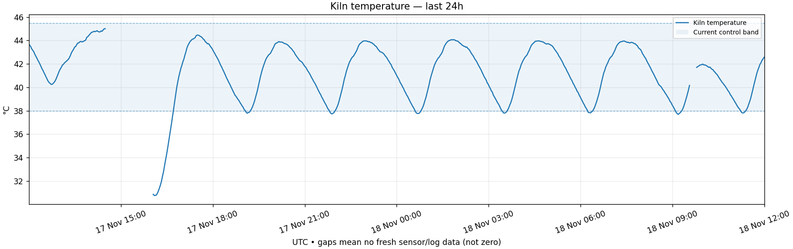
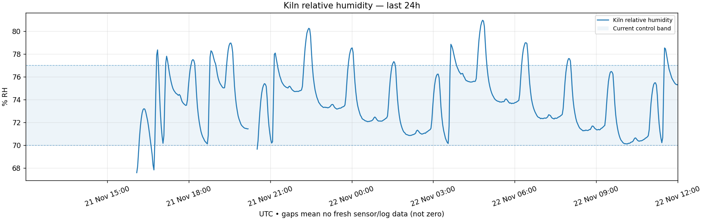
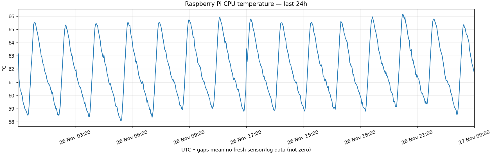
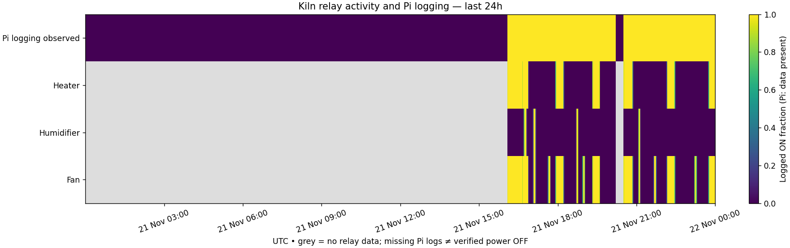
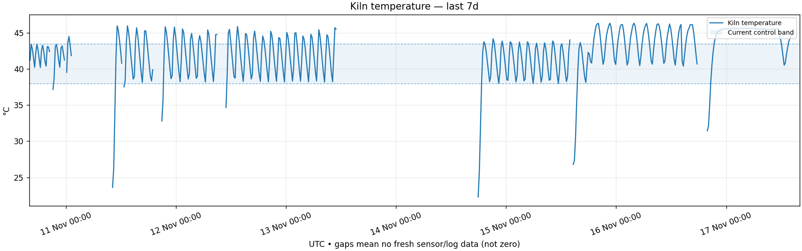
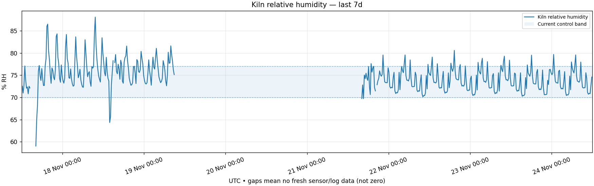
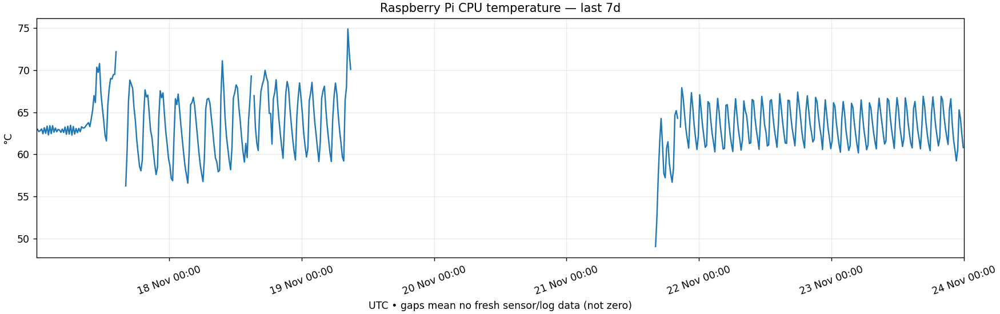
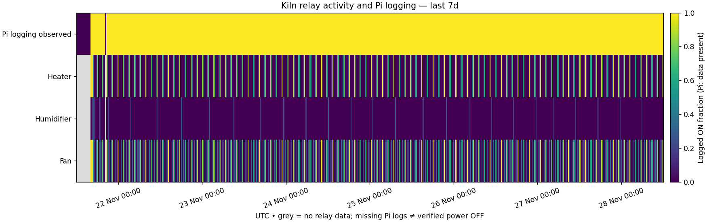

# Kiln plots — automatically refreshed every 12 hours

**[Live kiln status and alerts](https://github.com/HumphreyHCB/Kiln-Controller/issues/1)**

These are eight fixed PNG images, regenerated from the Pi's local CSV files at
approximately **00:00 and 12:00 UTC** each day (after installation). Each update
creates **one GitHub commit**, replacing the same image paths. No historic plots
are retained as separate filenames.

The charts use only the **last 24 hours** and **last 7 days** relative to the
generation time. They contain gaps when data is missing; missing data is **not**
treated as zero temperature, the heater being OFF, or proof of a powered-off Pi.

## Last 24 hours

### Kiln temperature

### Humidity

### Raspberry Pi CPU temperature

### Relay commands and Pi logging activity

## Last 7 days

### Kiln temperature

### Humidity

### Raspberry Pi CPU temperature

### Relay commands and Pi logging activity

## Reading these plots

- Kiln temperature and humidity use only **fresh, valid BLE readings**
  (`sensor_fault=0`, age at most 20 seconds). Previously cached stale sensor
  values are not plotted as current measurements.
- The dashed lines/shaded band reflect the **currently configured** thermostat
  values at publication, not necessarily settings from earlier in the week.
- Relay charts show the *fraction of samples commanding ON* in a time bucket:
  2-minute buckets (24h) and 15-minute buckets (7d). They do not measure
  electrical power or relay contact position.
- The row marked **Pi logging observed** means the Pi produced CSV records in
  that time bucket. Missing rows can indicate power loss, the controller being
  intentionally stopped, a logging failure, or other reasons; they **do not
  independently establish whether the Pi itself was powered OFF**.
- Grey relay cells mean **unknown due to no observations**, not OFF.
- [Publication metadata](last_updated.json) records the UTC generation time
  and CSV row counts. The plots can become stale if the Pi's publishing job
  stops; check that time before relying on them.

See [installation instructions](../automatic-plots.md) for setup and checking
the 12-hour timer.
